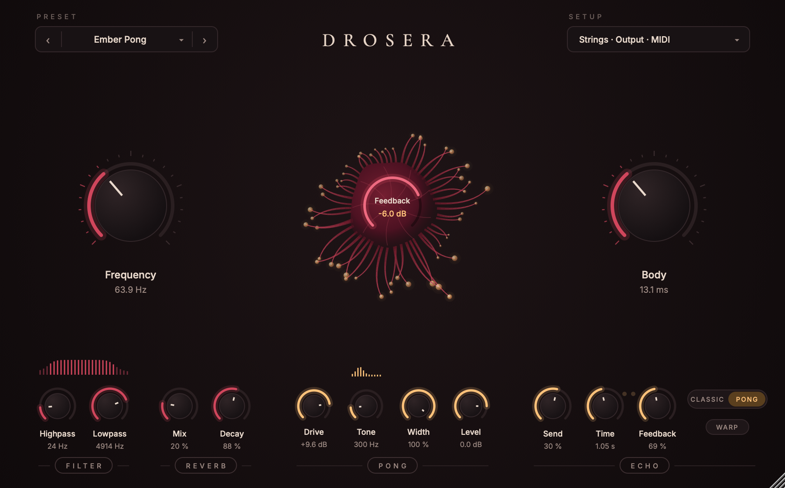

# Drosera



A feedback drone synth, as a VST3 plugin for macOS 11 or newer, on Apple silicon and Intel.

Drosera makes sound on its own: a noise floor feeds two string resonators inside a saturating loop, and you steer
what the loop settles on. Play it with its knobs, excite it with audio, or put it on a note with MIDI. It comes with
15 presets.

## Install

Download the zip from [Releases](https://github.com/codeskine/Drosera/releases), unpack it, and move `Drosera.vst3` to
`~/Library/Audio/Plug-Ins/VST3/`. Then rescan plugins in your host. Drosera loads as an instrument.

### If the plugin is blocked

Releases are not yet notarized by Apple, so macOS blocks files downloaded with a browser. After moving the plugin,
run this once in Terminal:

```bash
xattr -dr com.apple.quarantine ~/Library/Audio/Plug-Ins/VST3/Drosera.vst3
```

## Using it

See the [manual](docs/MANUAL.md) for every control, MIDI, and the known limits.

## Status

Validated by automated tests and `pluginval` on macOS. Not yet compared with a hardware unit.

## For developers

- [Building and testing](docs/BUILDING.md)
- [Contributing](CONTRIBUTING.md)
- [Releasing](docs/RELEASING.md)
- [Changelog](CHANGELOG.md)

## Credits

Derived from the MIT-licensed firmware of [Audrey II](https://github.com/Synthux-Academy/Audrey-II), by Nick Donaldson
(Synthux Academy), for Daisy Seed. Drosera is an independent project, not affiliated with or endorsed by Synthux
Academy, and uses none of their artwork.

## License

Copyright 2026 codeskine. AGPLv3, see [LICENSE](LICENSE). Third-party code keeps its own terms: see
[THIRD_PARTY_LICENSES.md](THIRD_PARTY_LICENSES.md).
